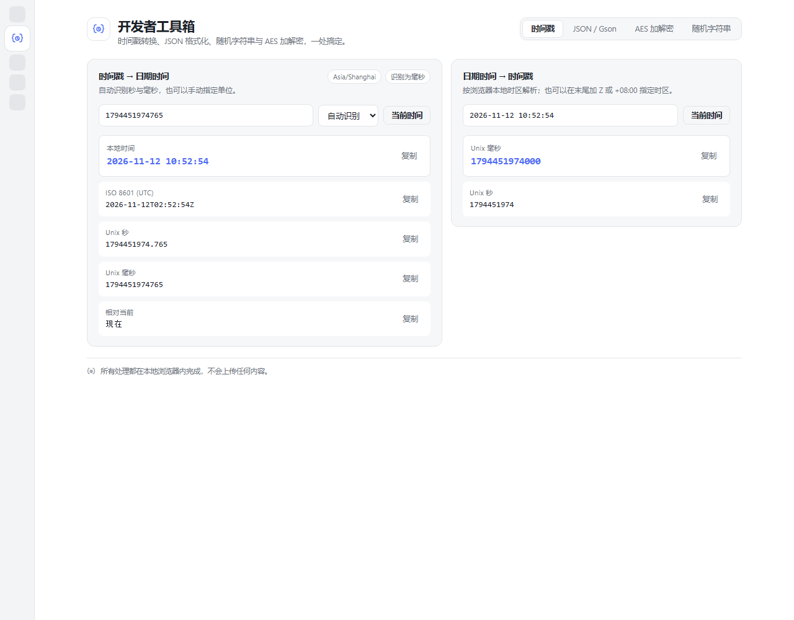
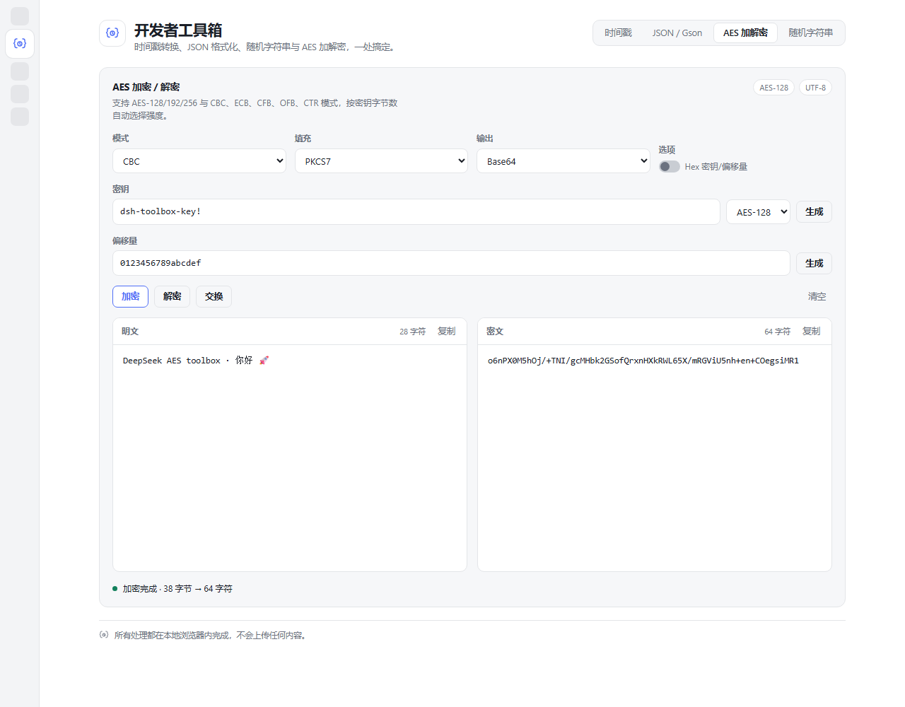

# DSH Developer Toolbox

A [DeepSeek Harness](https://github.com/deepseek-ai) plugin that adds a **Developer Toolbox** entry to
the left sidebar and a four-tab page: timestamp conversion, Gson-style JSON formatting/validation,
AES encryption/decryption and a random string generator. Everything runs locally in the renderer —
no network requests, no uploads.

[中文说明](README.zh-CN.md)



## Features

### 1. Timestamp converter

- **Timestamp → date time**: accepts Unix seconds (`1700000000`) or milliseconds
  (`1700000000000`). The unit is detected automatically (`>= 1e11` is treated as milliseconds)
  and can be forced with the unit selector.
- Shows `yyyy-MM-dd HH:mm:ss` in the local time zone, ISO 8601 UTC, Unix seconds, Unix
  milliseconds and a relative description; every row has a copy button.
- **Date time → timestamp**: parses `yyyy-MM-dd HH:mm:ss` (also a `T` separator, optional
  fractional seconds and optional `Z` / `+08:00` offset) and returns milliseconds and seconds.
- Invalid local times inside a daylight-saving gap are reported instead of silently shifted.
- Supported range is years `0001`–`9999`.

### 2. JSON / Gson formatter and validator

- Strict JSON parser (RFC 8259): comments, single quotes, trailing commas and unquoted keys are
  rejected with a stable error code, line/column and a code snippet with a caret.
- **Format** / **Minify** / **Validate** and **auto format** (280 ms debounce).
- Output style matches Gson's `JsonWriter` defaults: 2-space (or 4-space / tab) indent, a space
  after `:` and one item per line; numbers keep their original literal spelling (`1.0`, `1e5`).
- **Gson escaping** (on by default) escapes `<`, `>`, `&`, `=`, `'` as lowercase `\uXXXX`, like
  Gson's HTML-safe writer; turn it off for plain RFC 8259 escaping.
- Validation distinguishes invalid input, valid but unformatted input, and already standard format.
- Limits: 2,000,000 characters and 512 nesting levels.

### 3. AES encrypt / decrypt

- AES-128 / AES-192 / AES-256, selected by the actual key byte length (16 / 24 / 32).
- Modes **CBC, ECB, CFB, OFB, CTR**; padding **PKCS7, ZeroPadding, NoPadding**.
- Key and IV accept UTF-8 text or hex (toggle); generate buttons fill random bytes, and the key
  length select regenerates a matching key.
- Input/output encoding **Base64** or **hex** (optional uppercase hex); plaintext is UTF-8.
- Encrypt, decrypt, swap and clear in place; both panes have copy buttons. Errors (bad key length,
  invalid Base64/hex, wrong block length, PKCS7 failure) are reported with a specific message.
- Stream modes (CFB/OFB/CTR) ignore padding; ECB disables the IV field.
- Implemented in pure JavaScript inside `client.js`: no WebCrypto, no dependencies, no network.

### 4. Random string generator

- Character classes: uppercase letters, lowercase letters, digits.
- Custom **length** (1–256) and **count** (1–100).
- Optional **mixed** mode: every generated string contains at least one character of each selected
  class, then is shuffled.
- Uses `crypto.getRandomValues` with rejection sampling (falls back to `Math.random` only when the
  crypto API is unavailable). Copy a single string or all strings.



## Install

Requirements: a DeepSeek Harness desktop build with the Plugin Manager. The plugin is plain ESM
JavaScript, so there is no build step.

### From GitHub (recommended)

In a DSH session, ask the agent to install the bundle from this repository:

```text
plugin_manager  action: install_bundle  target: "github:zb5594921/dsh-dev-toolbox"
```

or paste the same spec into the Plugin Manager's install field. To pin a release, append the tag:

```text
github:zb5594921/dsh-dev-toolbox#v1.1.0
```

### From a clone

```bash
git clone https://github.com/zb5594921/dsh-dev-toolbox.git
```

then install the absolute path with `plugin_manager` action `install_bundle` (the directory that
contains this README).

After either route, **restart DSH** — bundle patches are composed at boot. The sidebar entry
“Developer Toolbox” opens the page in the main panel. To update, `remove_bundle` first and install
again, or install a newer tag.

## Package layout

| File | Purpose |
| --- | --- |
| `index.js` | Host half; intentionally no services (the plugin is UI-only). |
| `client.js` | Web client half: pure helpers, dictionaries, styles and the four panels. |
| `cordis.patch.yml` | Bundle patch that inserts the plugin entry. |
| `locale/en.json`, `locale/zh.json` | Plugin Manager title/description metadata. |
| `icon.svg` | Sidebar/plugin icon. |
| `test/` | Node test scripts (not shipped in the package `files` list). |
| `docs/` | Screenshots used by this README. |

## Development

Node.js 20+ is enough; there are no dependencies.

```bash
npm test
```

- `test/helpers.test.cjs` exercises the pure helpers under several time zones: timestamp parsing
  and formatting, `parseDateTimeInput` round-trips, DST gaps, the strict JSON parser (positions,
  depth, BOM, Gson escaping) and AES against the FIPS-197 vector plus Node's `crypto` for every
  mode and key size.
- `test/client.test.cjs` evals `client.js` with a tiny fake React and a fake plugin context: bundle
  registration, sidebar/main slot registrations, dictionary completeness in both locales, component
  rendering, and theme-token usage.

## Notes

- The plugin only styles itself with `--dsw-alias-*` theme tokens, so light and dark themes both
  work.
- JSON formatting preserves duplicate object keys (Gson's `JsonObject` would collapse them); every
  produced document is still valid JSON.
- AES is a conventional pure-JS implementation meant for developer convenience. It is not
  authenticated encryption — use AES-GCM (not offered here) when you need tamper detection.

## License

[MIT](LICENSE)
