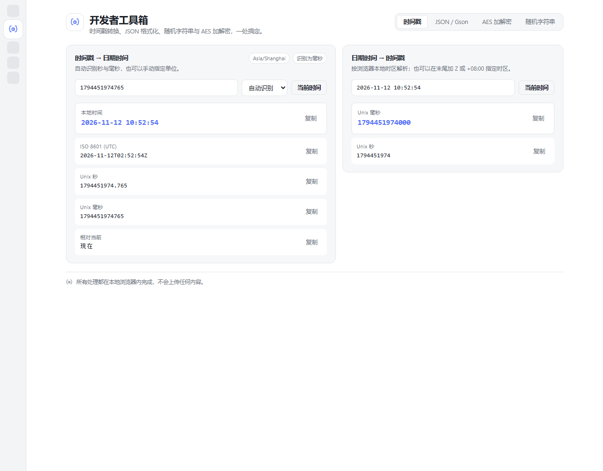
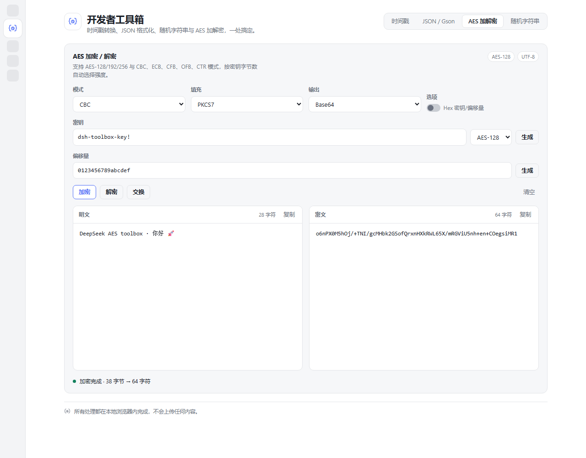

# DSH 开发者工具箱

一个 [DeepSeek Harness](https://github.com/deepseek-ai) 插件：在左侧栏新增「开发者工具箱」入口，打开一个四页签工具页——
时间戳转换、Gson 风格 JSON 格式化/校验、AES 加解密、随机字符串生成。所有处理都在本地渲染进程完成，不联网、不上传。

[English](README.md)



## 功能

### 1. 时间戳转换

- **时间戳 → 日期时间**：支持 Unix 秒（`1700000000`）与毫秒（`1700000000000`），默认自动识别
  （`>= 1e11` 视为毫秒），也可以手动指定单位。
- 同时给出本地时区的 `yyyy-MM-dd HH:mm:ss`、ISO 8601 UTC、Unix 秒、Unix 毫秒和相对时间，每行可复制。
- **日期时间 → 时间戳**：解析 `yyyy-MM-dd HH:mm:ss`（也接受 `T` 分隔、可选小数秒、可选 `Z` / `+08:00`
  时区），输出毫秒与秒。
- 夏令时跳变区间里的非法本地时间会报错，而不是被静默平移。
- 支持范围：年份 `0001`–`9999`。

### 2. JSON / Gson 格式化与校验

- 严格 JSON 解析（RFC 8259）：注释、单引号、尾随逗号、未加引号的键都会被拒绝，并给出稳定错误码、
  行列号与带插入符的代码片段。
- **格式化** / **压缩** / **校验格式**，以及**自动格式化**（280 ms 防抖）。
- 输出风格对齐 Gson `JsonWriter` 默认值：2 空格（或 4 空格 / Tab）缩进、冒号后空格、每行一项；
  数字保留原始字面量写法（`1.0`、`1e5`）。
- **Gson 转义**（默认开启）：把 `<`、`>`、`&`、`=`、`'` 转义为小写 `\uXXXX`，与 Gson 的 HTML-safe
  writer 一致；关闭后使用普通 RFC 8259 转义。
- 校验结果区分「非法」「合法但非标准格式」「已是标准格式」。
- 限制：2,000,000 字符、512 层嵌套。

### 3. AES 加解密

- AES-128 / 192 / 256，按密钥实际字节数（16 / 24 / 32）识别。
- 模式 **CBC、ECB、CFB、OFB、CTR**；填充 **PKCS7、ZeroPadding、NoPadding**。
- 密钥与偏移量支持 UTF-8 文本或 Hex（可切换）；一键随机生成，切换密钥长度时自动重生成密钥。
- 输入/输出编码 **Base64** 或 **hex**（hex 可切换大写）；明文按 UTF-8 处理。
- 原地加密/解密/交换/清空，明密文两栏都可复制；密钥长度错误、Base64/Hex 非法、分组长度不符、
  PKCS7 填充损坏等都有具体提示。
- CFB/OFB/CTR 流模式忽略填充；ECB 下偏移量输入框禁用。
- 纯 JavaScript 实现（`client.js` 内）：不使用 WebCrypto、无第三方依赖、不联网。

### 4. 随机字符串生成

- 字符类型：大写字母、小写字母、数字。
- 自定义**长度**（1–256）与**数量**（1–100）。
- 可选**每条都包含全部所选类型**：先保证每类至少一个字符，再打乱顺序。
- 使用 `crypto.getRandomValues` + 拒绝采样（仅在 crypto 不可用时回退 `Math.random`）；单条或批量复制。



## 安装

前提：桌面版 DeepSeek Harness（带 Plugin Manager）。插件是纯 ESM JavaScript，无需构建。

### 从 GitHub 安装（推荐）

在 DSH 会话里让智能体执行：

```text
plugin_manager  action: install_bundle  target: "github:zb5594921/dsh-dev-toolbox"
```

或把同样的 spec 粘贴到插件管理器的安装输入框。需要固定版本时追加 tag：

```text
github:zb5594921/dsh-dev-toolbox#v1.1.0
```

### 从本地克隆安装

```bash
git clone https://github.com/zb5594921/dsh-dev-toolbox.git
```

然后用 `plugin_manager` 的 `install_bundle` 安装该目录的绝对路径（含本 README 的目录）。

安装完成后请**重启 DSH**（bundle patch 在启动时组装）。左侧栏出现「开发者工具箱」，点击即可打开页面。
升级时先 `remove_bundle` 再安装新版本/tag。

## 目录结构

| 文件 | 说明 |
| --- | --- |
| `index.js` | Host 半部；故意不注册服务（纯 UI 插件）。 |
| `client.js` | Web 客户端半部：纯函数、双语文案、样式与四个面板。 |
| `cordis.patch.yml` | 把插件条目插入 Loader 的 bundle patch。 |
| `locale/en.json`、`locale/zh.json` | 插件管理器读取的标题/描述元数据。 |
| `icon.svg` | 侧栏/插件图标。 |
| `test/` | Node 测试脚本（不在 `files` 打包列表中）。 |
| `docs/` | README 使用的截图。 |

## 开发

只需要 Node.js 20+，没有依赖。

```bash
npm test
```

- `test/helpers.test.cjs`：在多个时区下覆盖时间戳解析/格式化、`parseDateTimeInput` 往返、夏令时跳变、
  严格 JSON 解析（位置、深度、BOM、Gson 转义），以及 AES（FIPS-197 向量 + Node `crypto` 对照全部模式与密钥长度）。
- `test/client.test.cjs`：用极简假 React 与假插件上下文执行 `client.js`，检查 bundle 注册、侧栏/主面板
  注册、双语文案完整性、组件渲染与主题 token 使用。

## 说明

- 样式只使用 `--dsw-alias-*` 主题 token，浅色/深色主题均可用。
- JSON 格式化会保留重复键（Gson 的 `JsonObject` 会合并），产出的文档仍是合法 JSON。
- AES 是面向开发便利的常规纯 JS 实现，不是认证加密；需要防篡改时请使用 AES-GCM（本插件未提供）。

## 许可证

[MIT](LICENSE)
